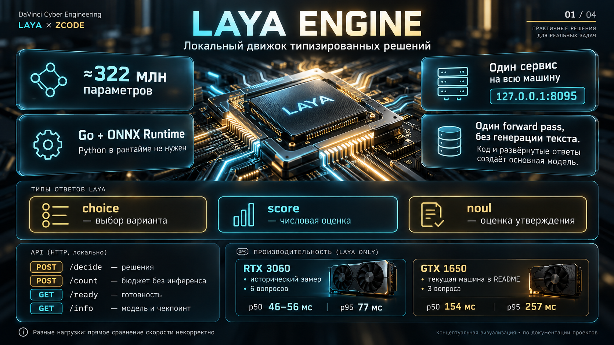
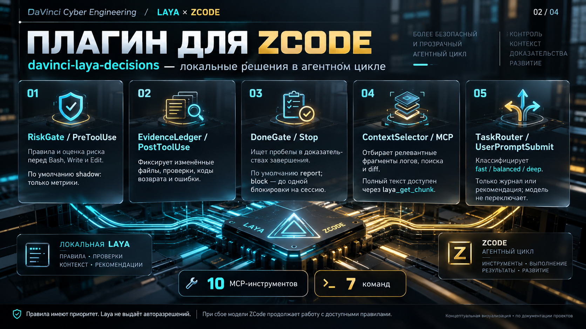
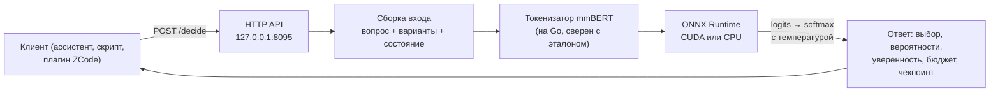
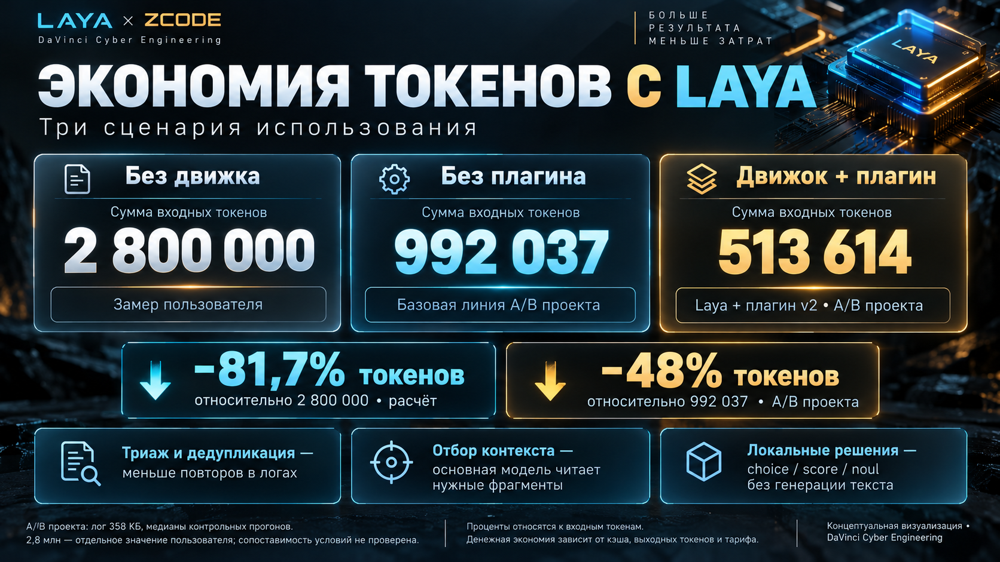
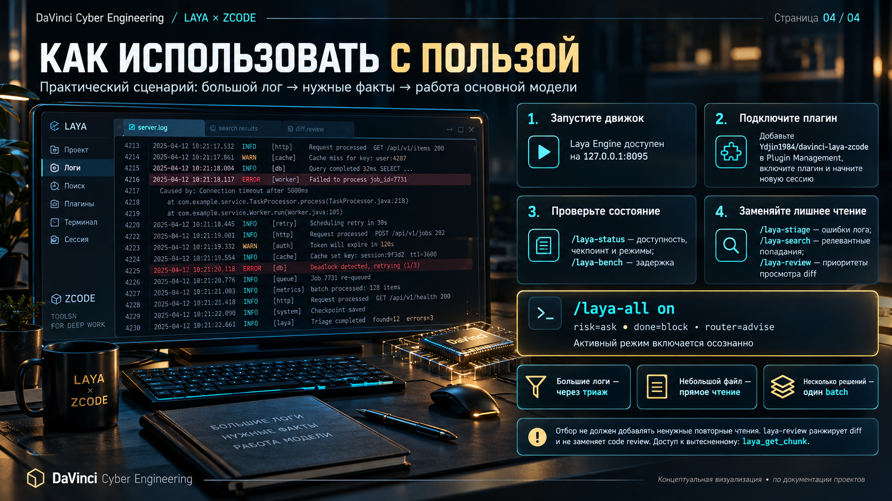
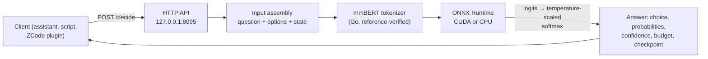

<div align="center">

# LAYA ENGINE

**Локальный движок типизированных решений · Local typed-decision engine**

Go + ONNX Runtime · ~322M параметров · GPU или CPU · без Python в рантайме
· один forward pass на запрос · без генерации текста

[](LICENSE)
[](go.mod)
[](https://github.com/microsoft/onnxruntime/releases/tag/v1.25.0)
[](https://huggingface.co/convaiinnovations/laya)
[](#быстрый-старт--quick-start)
[](docs/BENCHMARKS.md)
[](.github/workflows/ci.yml)

<a href="#-русский">🇷🇺 Русский</a> · <a href="#-english">🇬🇧 English</a>



</div>

---

# 🇷🇺 Русский

## Что это простыми словами

Представьте, что у большой языковой модели есть быстрый помощник, который
отвечает не текстом, а **конкретным решением**: «какой это тип задачи?», «насколько
это опасно?», «верно ли утверждение?». Laya Engine — это такой помощник,
работающий **на вашем компьютере**: ~322 млн параметров вместо сотен миллиардов,
десятки-сотни миллисекунд вместо секунд, ноль обращений в интернет.

Три ключевые идеи:

1. **Не генерация, а решение.** Модель за один forward pass выдаёт вероятности по
   вашим вариантам (`choice`), оценку по шкале (`score`) или P(истина) для
   утверждения (`noul`). Она не пишет код и не «рассуждает» — она быстро отвечает
   на узкие вопросы о коротком тексте.
2. **Один сервис на всю машину.** Всё живёт на `127.0.0.1:8095`: ассистенты,
   скрипты, задачи обработки данных ходят в один процесс, а не поднимают каждый
   свои копии весов.
3. **Где дешевле вычислить, чем рассуждать.** Типизация задачи, оценка риска
   действия, триаж лога, ранжирование контекста — на это большая модель тратит
   секунды и токены, а локальный движок — десятки миллисекунд и ноль токенов.



## Как это работает



- **Один запрос — один проход модели.** Все вопросы батча считаются вместе:
  «цена» запроса зависит от числа вопросов и длины состояния, а не от
  параллелизма (≈1 мс на входной токен на GTX 1650).
- **Чекпоинт — часть контракта.** Каждый ответ несёт sha256 весов
  (`multilingual-fp16-0b095e005a4c`): пороги и замеры нельзя перенести на другие
  веса незаметно.
- **Обрезка видна клиенту.** Если состояние не влезло, ответ помечается
  (`state_truncated`, `collapsed`) — клиент обязан считать такой ответ
  недостоверным, а не «уверенным».

## Что даёт на практике: −48 % токенов на большом логе



Замер: разбор лога на **7 000 строк (358 КБ)** субагентом в двух режимах — «читать
целиком» против «сначала триаж и ранжирование, потом чтение только нужного».
Медианы контрольных прогонов:

| Показатель | Без плагина | С плагином | Δ |
|---|---|---|---|
| Сумма входных токенов | 992 037 | **513 614** | **−48 %** |
| Пик контекста | 223 663 | **94 455** | **−58 %** |
| Время вызовов модели | 23,8 с | 23,5 с | ≈0 |
| Полнота ответа | 3/3 | 3/3 | = |

Честные оговорки, без которых график обманчив: на **маленьком** логе (влезает в
одно чтение) инструмент добавляет round-trip и проигрывает (+73 %), а поиск по
20 попаданиям даёт паритет. **Правило окупаемости:** отбор контекста оправдан,
только если он *заменяет* чтение целиком. Полная методика, сырые журналы и
формулы — [docs/BENCHMARKS.md](docs/BENCHMARKS.md).

## Как использовать с пользой



Сценарий целиком: **1)** запустить движок → **2)** подключить плагин ZCode →
**3)** проверить состояние → **4)** заменить лишнее чтение инструментами отбора.
Команды: `/laya-status`, `/laya-all on` (включить активные режимы осознанно),
`/laya-triage` (ошибки лога), `/laya-search` (релевантные попадания),
`/laya-review` (приоритеты diff), `/laya-bench` (задержка).

---

## Быстрый старт / Quick start

| Платформа | Одна команда |
|---|---|
| **Windows 10/11 x64** | `install.cmd` (GPU) · `install.cmd -Cpu` · `install.cmd -Prebuilt` · `install.cmd -Service -Plugin` |
| **Linux** | `./scripts/install.sh` · `--cpu` · `--prebuilt` · `--service --plugin` |
| **macOS** | `xcode-select --install && ./scripts/install.sh --cpu` |
| **Docker** | `./scripts/fetch-model.sh && docker compose up --build laya-cpu` |

Что происходит: скачиваются веса (617 МБ, SHA-256), ONNX Runtime 1.25.0, при
необходимости CUDA 12/cuDNN 9; собирается сервис (или берётся готовый бинарник);
запускается self-test. Дальше:

```bash
./scripts/laya.sh start | status | logs | stop     # Linux/macOS
start-laya.cmd            | stop-laya.cmd          :: Windows
```

Без видеокарты всё работает: `--cpu` / `/cpu` (медленнее, но без NVIDIA-стека).
Полный гид по платформам, автозапуску (Task Scheduler / systemd / launchd) и
диагностике — [docs/INSTALL.md](docs/INSTALL.md).

## Подключение плагина и навыка ZCode

Плагин **`davinci-laya-decisions`** встраивает движок в агентный цикл ZCode:
гейт риска перед опасными вызовами (по умолчанию shadow — только метрики),
ledger изменений, проверка доказательств завершения, ранжирование контекста и
**10 MCP-инструментов**. Вместе с плагином устанавливается **навык**
`laya-decision-workflow` — правило, когда инструменты окупаются.

```text
Settings → Plugin Management → Discover → «+» → GitHub repository
→ Ydjin1984/davinci-laya-zcode  →  включить «DaVinci × Laya: локальные решения»
→ новая сессия ZCode → /laya-status
```

Или скриптом: `./scripts/install-plugin.sh` (Linux/macOS) /
`powershell -ExecutionPolicy Bypass -File scripts\windows\install-plugin.ps1`.
Репозиторий плагина: <https://github.com/Ydjin1984/davinci-laya-zcode>.
Подробности: [integrations/zcode/README.md](integrations/zcode/README.md).

## API за минуту

| Метод | Путь | Назначение |
|---|---|---|
| POST | `/decide` | батч вопросов `choice` / `score` / `noul` по одному состоянию |
| POST | `/count` | бюджеты без инференса (~1 мс): влезает ли состояние |
| GET | `/info` | устройство, чекпоинт, лимиты, счётчики |
| GET | `/ready` · `/health` | готовность / живость |
| POST | `/benchmark` | p50/p95/p99 на вашей машине |
| GET/POST | `/v1/models` · `/v1/systemone` | Jev-совместимый фасад |

```bash
curl -s http://127.0.0.1:8095/decide -H 'Content-Type: application/json' -d '{
  "state": "удали файл D:\\tmp\\old.txt и покажи список",
  "questions": {
    "route": {"type":"choice","instructions":"Какой набор инструментов нужен?",
      "criteria":{"dialog":"ответить словами","files_write":"изменить или удалить файл","console":"выполнить команду"}},
    "data_loss": {"type":"noul","instructions":"Уничтожит ли это действие несохранённые или невосстановимые данные пользователя (сброс изменений, удаление файлов, перезапись без копии)?"}
  }}'
# → route: files_write (0.985) · data_loss: 0.912 · checkpoint: multilingual-fp16-0b095e005a4c
```

Полный контракт, семантика полей (`answer_confidence` — калиброванная величина,
порог — по ней) и **правила формулировки вопросов** (модель 322M чувствительна к
формулировке: короткое «изменяет ли запрос состояние?» даёт ложный ноль, полное
утверждение о действии — 0.912): [docs/API.md](docs/API.md).

## Производительность

| Нагрузка | p50 | p95 |
|---|---|---|
| RTX 3060, 6 вопросов/запрос (исторический замер) | 46–56 мс | 77 мс |
| GTX 1650, 3 вопроса/запрос (текущая тестовая машина) | 154 мс | 257 мс |

Время линейно по входным токенам (≈1 мс/токен на GTX 1650), все операторы — на
CUDA. Проверить на своей машине: `POST /benchmark`.
Модель: fp16, ~322M параметров (энкодер mmBERT + голова типизированных решений),
`max_len=1024`, `head_max_len=256`.

## Структура репозитория

```
01..04_*.png          четыре иллюстрации серии (в корне, по одной на раздел)
cmd/laya-server/      точка входа сервиса (флаги, прогрев, логи)
engine/               ONNX-сессия, сборка входа, вопросы, CUDA-окружение
tokenizer/            токенизатор mmBERT на Go (сверен с HuggingFace)
server/               HTTP API, бенчмарк, Jev-фасад
scripts/              кросс-платформенные скрипты (install, fetch-*, laya.sh, плагин)
tools/                инструменты разработки: эталоны, диагностика, профилирование
docs/                 INSTALL · API · BENCHMARKS · ARCHITECTURE · ENGINE.ru · ТЗ интеграции
examples/             примеры клиентов: curl, PowerShell, Python, Node
docker/               образы CPU и GPU + compose
integrations/zcode/   плагин и навык ZCode: установка и измеренный эффект
laya_arcade/          демо: три игры, в которые играет Laya, и нейроэволюция рядом
models/ third_party/  пусто в git: веса и библиотеки скачивают скрипты (SHA-256)
```

## Правила эффективного использования

1. **Большие артефакты — через триаж.** Лог в мегабайты целиком не влезет; отбор
   окупается на порядки (см. −48 %/−58 %).
2. **Маленькие файлы — читайте напрямую.** Если артефакт влезает в одно чтение,
   отбор добавляет round-trip, который нечем оплатить.
3. **Несколько решений — один batch.** Независимые вопросы в один вызов: один
   forward pass вместо N.
4. **Решающие факты — в начало состояния.** Состояние режется справа; хвост
   модель может не увидеть.
5. **Порог — по `answer_confidence`**, и он привязан к чекпоинту.
6. **Вероятность ≠ доказательство.** Ответы модели не расширяют разрешения и не
   заменяют факты (`git status`, коды возврата тестов).
7. **Калибруйте на своих данных.** Чужие пороги — стартовая точка, не истина.

## Документация

| Документ | О чём |
|---|---|
| [docs/INSTALL.md](docs/INSTALL.md) | установка на Windows/Linux/macOS/Docker, автозапуск, удаление, диагностика |
| [docs/API.md](docs/API.md) | полный контракт HTTP API, семантика полей, формулировки вопросов |
| [docs/BENCHMARKS.md](docs/BENCHMARKS.md) | латентность, модель стоимости, A/B экономии токенов, чего числа не показывают |
| [docs/ARCHITECTURE.md](docs/ARCHITECTURE.md) | устройство: слои, поток одного `/decide`, CUDA-окружение, интеграция |
| [docs/ENGINE.ru.md](docs/ENGINE.ru.md) | глубокая техническая справка по движку (RU) |
| [docs/TZ-ZCode-Laya-Integration.md](docs/TZ-ZCode-Laya-Integration.md) | ТЗ интеграции ZCode × Laya (архитектура решения) |
| [integrations/zcode/README.md](integrations/zcode/README.md) | плагин: компоненты, установка, измеренный эффект |
| [AGENTS.md](AGENTS.md) | правила для coding-агентов, работающих в этом репозитории |
| [CONTRIBUTING.md](CONTRIBUTING.md) · [SECURITY.md](SECURITY.md) | вклад и безопасность |

## Лицензии

Код этого репозитория — Apache-2.0 ([LICENSE](LICENSE)). Модель Laya —
Apache-2.0 (`convaiinnovations/laya`); ONNX Runtime — MIT. CUDA/cuDNN не
распространяются: скрипты скачивают их из публичных колёс NVIDIA, условия —
NVIDIA CUDA Toolkit EULA. Полный список — [NOTICE](NOTICE).

---

# 🇬🇧 English

## What it is, in plain words

A big LLM sometimes needs a fast assistant that answers not with text, but with a
**concrete decision**: "what kind of task is this?", "how risky is this action?",
"is this statement true?". Laya Engine is that assistant, running **on your own
machine**: ~322M parameters instead of hundreds of billions, tens of milliseconds
instead of seconds, zero network calls.

Three core ideas:

1. **Decisions, not generation.** In one forward pass the model returns
   probabilities over your options (`choice`), a level on an ordered scale
   (`score`), or P(true) for a statement (`noul`). No code writing, no reasoning —
   just fast, typed answers about short text.
2. **One service per machine.** Everything lives on `127.0.0.1:8095`: assistants,
   scripts and data jobs share a single process instead of loading their own copies
   of the weights.
3. **Cheaper to compute than to reason about.** Task classification, action-risk
   scoring, log triage, context ranking: a big model spends seconds and tokens on
   this; the local engine spends tens of milliseconds and zero tokens.


## How it works



- **One request — one model pass.** All questions in a batch are computed together;
  cost is driven by the number of questions and the state length, not concurrency
  (≈1 ms per input token on a GTX 1650).
- **The checkpoint is part of the contract.** Every answer carries the weights
  sha256 (`multilingual-fp16-0b095e005a4c`): thresholds and measurements cannot be
  silently carried over to different weights.
- **Truncation is explicit.** If the state did not fit, the answer is flagged
  (`state_truncated`, `collapsed`) and must be treated as unreliable.

## Measured effect: −48 % tokens on a large log


Parsing a **7,000-line (358 KB) log** with a subagent in two modes: "read it whole"
vs "triage and rank first, then read only what matters". Medians:

| Metric | Without plugin | With plugin | Δ |
|---|---|---|---|
| Sum of input tokens | 992,037 | **513,614** | **−48 %** |
| Peak context | 223,663 | **94,455** | **−58 %** |
| Model time | 23.8 s | 23.5 s | ≈0 |
| Answer completeness | 3/3 | 3/3 | = |

Honest caveats: on a **small** log (fits in one read) the tool adds a round-trip
and loses (+73 %); repository search over ~20 hits is at parity. **Payoff rule:**
selection is worth it only when it *replaces* a full read.
Full method, raw journals and formulas: [docs/BENCHMARKS.md](docs/BENCHMARKS.md).

## Using it well


The full scenario: **1)** start the engine → **2)** connect the ZCode plugin →
**3)** check status → **4)** replace unnecessary reading with selection tools.
Commands: `/laya-status`, `/laya-all on` (enable active modes deliberately),
`/laya-triage` (log errors), `/laya-search` (relevant hits), `/laya-review`
(diff priorities), `/laya-bench` (latency).

## Quick start

| Platform | One command |
|---|---|
| **Windows 10/11 x64** | `install.cmd` · `install.cmd -Cpu` · `install.cmd -Prebuilt` · `install.cmd -Service -Plugin` |
| **Linux** | `./scripts/install.sh` · `--cpu` · `--prebuilt` · `--service --plugin` |
| **macOS** | `xcode-select --install && ./scripts/install.sh --cpu` |
| **Docker** | `./scripts/fetch-model.sh && docker compose up --build laya-cpu` |

The installer downloads the weights (617 MB, SHA-256 checked), ONNX Runtime
1.25.0, and CUDA 12 / cuDNN 9 when needed; builds the service (or fetches the
prebuilt binary) and runs a self-test. Then:

```bash
./scripts/laya.sh start | status | logs | stop     # Linux/macOS
start-laya.cmd            | stop-laya.cmd          :: Windows
```

No GPU? Everything works on CPU (`--cpu` / `/cpu`), just slower. Full guide with
autostart (Task Scheduler / systemd / launchd) and troubleshooting:
[docs/INSTALL.md](docs/INSTALL.md).

## ZCode plugin and skill

The **`davinci-laya-decisions`** plugin wires the engine into the agent cycle: a
risk gate before dangerous calls (shadow by default — metrics only), an evidence
ledger, a completion gate, context ranking, and **10 MCP tools**. It ships a
**skill** (`laya-decision-workflow`) that teaches the model when those tools pay
off.

```text
Settings → Plugin Management → Discover → "+" → GitHub repository
→ Ydjin1984/davinci-laya-zcode  →  enable "DaVinci × Laya: local decisions"
→ new ZCode session → /laya-status
```

Or scripted: `./scripts/install-plugin.sh` /
`powershell -ExecutionPolicy Bypass -File scripts\windows\install-plugin.ps1`.
Plugin repository: <https://github.com/Ydjin1984/davinci-laya-zcode>.
Details: [integrations/zcode/README.md](integrations/zcode/README.md).

## API in a minute

| Method | Path | Purpose |
|---|---|---|
| POST | `/decide` | batch of `choice` / `score` / `noul` questions over one state |
| POST | `/count` | budgets without inference (~1 ms): does the state fit |
| GET | `/info` | device, checkpoint, limits, counters |
| GET | `/ready` · `/health` | readiness / liveness |
| POST | `/benchmark` | p50/p95/p99 on your machine |
| GET/POST | `/v1/models` · `/v1/systemone` | Jev-compatible facade |

Full contract, field semantics (`answer_confidence` is the calibrated value —
threshold on it) and **question-wording rules** (a 322M model is wording-sensitive:
"does the request modify state?" returns a false zero, a full concrete statement
returns 0.912): [docs/API.md](docs/API.md).

## Performance

| Load | p50 | p95 |
|---|---|---|
| RTX 3060, 6 questions/request (historical) | 46–56 ms | 77 ms |
| GTX 1650, 3 questions/request (current test box) | 154 ms | 257 ms |

Time is linear in input tokens (≈1 ms/token on the GTX 1650); every operator runs
on CUDA. Measure your own box with `POST /benchmark`. Model: fp16, ~322M params
(mmBERT encoder + typed-decision head), `max_len=1024`, `head_max_len=256`.

## Repository layout

```
01..04_*.png          the four illustrations (repo root, one per section)
cmd/laya-server/      service entry point (flags, warm-up, logging)
engine/               ONNX session, input assembly, questions, CUDA environment
tokenizer/            mmBERT tokenizer in Go (verified against HuggingFace)
server/               HTTP API, benchmark, Jev facade
scripts/              cross-platform scripts (install, fetch-*, laya.sh, plugin)
tools/                developer tooling: references, diagnostics, profiling
docs/                 INSTALL · API · BENCHMARKS · ARCHITECTURE · ENGINE.ru · integration spec
examples/             clients: curl, PowerShell, Python, Node
docker/               CPU and GPU images + compose
integrations/zcode/   ZCode plugin and skill: install and measured effect
laya_arcade/          demo: three games Laya plays, plus neuroevolution alongside
models/ third_party/  empty in git: scripts fetch weights and libraries (SHA-256)
```

## Rules for effective use

1. **Large artifacts → triage.** A multi-megabyte log will not fit; selection pays
   off by orders of magnitude (−48 %/−58 % above).
2. **Small files → read directly.** If it fits in one read, selection adds a
   round-trip nobody pays for.
3. **Several decisions → one batch call.** One forward pass instead of N.
4. **Decision-critical facts go first.** The state is cut from the right.
5. **Threshold on `answer_confidence`**, and bind it to the checkpoint.
6. **Probability is not proof.** Model answers never widen permissions and never
   replace facts (`git status`, test exit codes).
7. **Calibrate on your own data.** Someone else's thresholds are a starting point.

## Documentation

| Document | About |
|---|---|
| [docs/INSTALL.md](docs/INSTALL.md) | install on Windows/Linux/macOS/Docker, autostart, uninstall, troubleshooting |
| [docs/API.md](docs/API.md) | full HTTP contract, field semantics, question wording |
| [docs/BENCHMARKS.md](docs/BENCHMARKS.md) | latency, cost model, token-saving A/B, what the numbers do not show |
| [docs/ARCHITECTURE.md](docs/ARCHITECTURE.md) | internals: layers, one `/decide` flow, CUDA environment, integration |
| [docs/ENGINE.ru.md](docs/ENGINE.ru.md) | deep technical reference (Russian) |
| [integrations/zcode/README.md](integrations/zcode/README.md) | the plugin: components, install, measured effect |
| [AGENTS.md](AGENTS.md) | rules for coding agents working in this repository |
| [CONTRIBUTING.md](CONTRIBUTING.md) · [SECURITY.md](SECURITY.md) | contributions and security |

## License

Repository code: Apache-2.0 ([LICENSE](LICENSE)). Laya model: Apache-2.0
(`convaiinnovations/laya`); ONNX Runtime: MIT. CUDA/cuDNN are not redistributed —
scripts download them from public NVIDIA wheels under the NVIDIA CUDA Toolkit
EULA. Full list: [NOTICE](NOTICE).

---

<div align="center">

### Keywords / Хэштеги

`#LayaEngine` `#ONNXRuntime` `#GoLang` `#CUDA` `#cuDNN` `#SystemOne`
`#DecisionEngine` `#LocalAI` `#LocalLLM` `#TokenEfficiency` `#ContextEngineering`
`#ZCode` `#MCP` `#ModelContextProtocol` `#CodeAgents` `#DeveloperTools`
`#AIAgents` `#mmBERT` `#BPE` `#ONNX` `#fp16` `#CrossPlatform` `#Windows` `#Linux`
`#macOS` `#Docker` `#Apache2` `#OpenSource` `#AgentSafety` `#TokenSavings`

**DaVinci Cyber Engineering · 2026**

</div>
