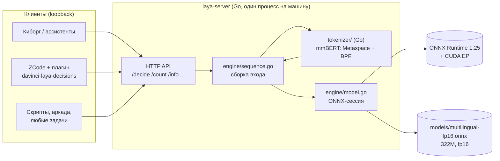
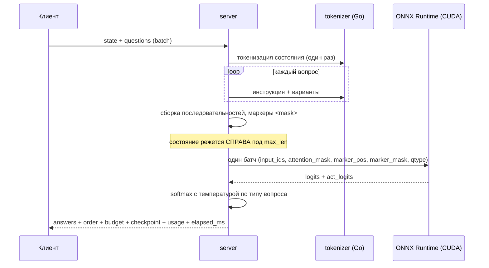
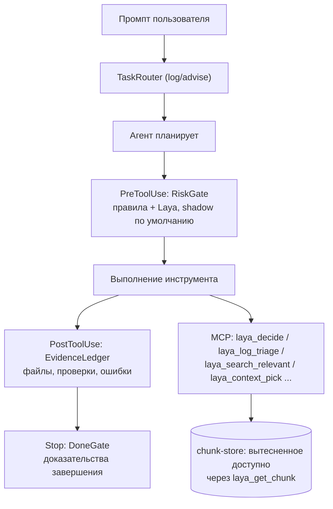

# Архитектура / Architecture

Двуязычный документ: русский текст, затем английская версия
([English version below](#architecture-english)).

---

# 🇷🇺 Архитектура (русский)

## Общая картина



Один процесс обслуживает все проекты машины: клиенты ходят по loopback, а не
поднимают свои копии весов. Python в рантайме не участвует.

## Слои

| Слой | Файл | Ответственность |
|---|---|---|
| HTTP API | `server/server.go` | маршруты, разбор запроса, ответы, бенчмарк, Jev-фасад |
| Вход | `cmd/laya-server/main.go` | флаги/переменные, прогрев, логи, чекпоинт до загрузки весов |
| Сборка входа | `engine/sequence.go` | последовательность `[CLS] вопрос [SEP] [MASK]варианты… [SEP] состояние [SEP]` |
| Вопросы | `engine/question.go` | разбор `choice`/`score`/`noul`, рендер вариантов (порядок ключей сохраняется) |
| Токенизация | `tokenizer/tokenizer.go` | mmBERT: `Replace(" "→"▁")` + Metaspace + BPE с byte_fallback |
| Инференс | `engine/model.go` | ONNX-сессия (CUDA/CPU), батч вопросов, декодирование логитов, температуры |
| CUDA-окружение | `engine/cudaenv.go` | поиск и подключение библиотек CUDA 12 / cuDNN 9 до инициализации ORT |
| Чекпоинт | `engine/model.go` | sha256 весов → короткий id `multilingual-fp16-0b095e005a4c` |

## Что происходит внутри одного `/decide`



Ключевые решения:

1. **Один forward pass на запрос.** Все вопросы батча считаются вместе; порядок
   `answers` в JSON не гарантирован, поэтому в ответе есть `order`.
2. **Температура по типу вопроса** (`choice`/`score`/`noul`), clamp 0.5..5.0.
   Порог клиента ставится по `answer_confidence` = max(p) — калиброванной
   величине.
3. **Явные признаки обрезки.** `budget.state_truncated`, `state_dropped`,
   `head_truncated`, `collapsed` — состояние режется справа, и клиент обязан
   трактовать обрезанный ответ как недостоверный, а не «уверенный».
4. **Прогрев.** После загрузки выполняются две формы запроса (маршрут из 6
   вопросов и риск-гейт из 1 вопроса): первый вызов на GPU стоит в разы дороже
   последующих, и без прогрева первые реальные запросы не укладывались в
   таймауты клиентов.

## Токенизатор

Препроцессинг повторяет эталон (Python-экспорт Laya) один в один:

1. нормализация пробелов в `▁`;
2. претокенайзер Metaspace с `prepend_scheme=always`;
3. BPE с `byte_fallback`;
4. позиции маркеров на токенах `<mask>` каждого варианта.

Любое расхождение здесь не даёт ошибки — оно **молча меняет ответы**, поэтому
сверка с HF tokenizers зафиксирована тестом (32 контрольные строки) и тяжёлым
тестом против Python-эталона (200 кейсов, 1200 ответов) под `LAYA_HEAVY=1`.

## CUDA-окружение

CUDA-провайдер ONNX Runtime 1.25 собран под CUDA 12 и ищет конкретные имена
(`cudart64_12.dll`, `cublas64_12.dll`, `cublasLt64_12.dll`, `cudnn64_9.dll`,
`cufft64_11.dll`). Системный toolkit 13.x их не содержит. Каталоги
подключаются **до** инициализации ORT:

- Windows: добавление каталогов в `PATH` процесса (`engine/cudaenv.go`);
- Linux/macOS: `LD_LIBRARY_PATH` / `DYLD_LIBRARY_PATH` в стартовом скрипте —
  динамический загрузчик читает их при старте процесса.

Откат CUDA→CPU **по умолчанию запрещён** (`-allow-cpu-fallback=false`):
молчаливый откат уже приводил к тому, что «замеры на видеокарте» шли на
процессоре. Если CUDA не поднимается, сервис падает с внятной ошибкой.

## Интеграция с ZCode



Принципы: **вероятность ≠ доказательство** (правила и факты приоритетны, Laya
никогда не расширяет разрешения), **fail-open** (Laya недоступна — ZCode
работает штатно), **измерять, а не обещать** (все решения — в локальные
метрики). Реализация — отдельный репозиторий
<https://github.com/Ydjin1984/davinci-laya-zcode>.

## Структура репозитория

```
cmd/laya-server/      точка входа, флаги, прогрев
cmd/laya-profile/     снятие ORT-профиля на сценарии риск-гейта
server/server.go      HTTP API, бенчмарк, Jev-фасад
engine/               ONNX-сессия, сборка последовательности, вопросы, CUDA-окружение
tokenizer/            mmBERT-токенизатор на Go
scripts/              кросс-платформенные скрипты (установка, запуск, сервис, плагин)
tools/                инструменты разработки: эталоны, диагностика, профилирование
docs/                 документация (двуязычный README, INSTALL, API, BENCHMARKS)
laya_arcade/          демо: три игры, в которые играет Laya
docker/               образы CPU/GPU
integrations/zcode/   установка плагина и навыка ZCode
```

---

# 🇬🇧 Architecture (English)

**One process per machine.** All local clients (assistants, scripts, trading and
data jobs) talk to it over loopback instead of loading their own copies of the
weights. No Python at runtime: the tokenizer and the whole input assembly are Go.

**Pipeline:** HTTP API → sequence assembly
(`[CLS] question [SEP] [MASK]options… [SEP] state [SEP]`) → Go tokenizer
(mmBERT: Metaspace + byte-fallback BPE) → a single batched ONNX Runtime forward
pass (CUDA or CPU) → calibrated softmax per question type.

**Key decisions:**

1. **One forward pass per request** — all questions of a batch are computed
   together; `answers` key order is not guaranteed, so the response carries
   `order`.
2. **Temperature per question type**, clamped to 0.5..5.0; thresholds belong on
   `answer_confidence` = max(p), the calibrated value.
3. **Explicit truncation flags** — the state is cut from the right;
   `state_truncated` / `state_dropped` / `head_truncated` / `collapsed` must be
   treated as "answer unreliable", never ignored.
4. **Warm-up after load** with two request shapes (6-question route, 1-question
   risk gate): the first GPU call is several times more expensive than the rest.
5. **CUDA→CPU fallback is forbidden by default** — a silent fallback once made
   "GPU measurements" actually run on the CPU. The engine fails loudly instead.
6. **Checkpoint identity** — the sha256 of the weights becomes the short id
   `multilingual-fp16-0b095e005a4c` carried by every answer; thresholds are bound
   to it.

**Why the tokenizer is test-locked:** preprocessing differences produce no error,
they silently change the model's answers. Verification against HF tokenizers
(32 cases) runs in CI; the heavy 200-case reference comparison runs with
`LAYA_HEAVY=1`.

**ZCode integration:** the plugin wraps the engine into agent-cycle control
points (risk gate on PreToolUse, evidence ledger on PostToolUse, completion gate
on Stop, context ranking over MCP). Three principles: probability is not proof,
fail-open, measure instead of promising. See
<https://github.com/Ydjin1984/davinci-laya-zcode>.
