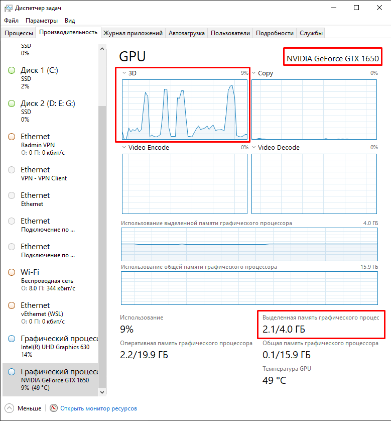

# Замеры и производительность / Benchmarks

Двуязычный документ: русский текст, затем английская версия
([English version below](#benchmarks-english)).

Все числа — из документации проекта и сырых журналов; ничего не оценивалось
«на глаз». Абсолютные значения — про тестовые машины (см. таблицу железа) и
чекпоинт `multilingual-fp16-0b095e005a4c`; на другой видеокарте числа будут
другими, порядок величины сохранится.

---

# 🇷🇺 Замеры (русский)

## Железо замеров

| Машина | GPU | Роль |
|---|---|---|
| Тестовая (текущая) | GTX 1650 4 ГБ (Turing, без тензорных ядер) | все текущие числа |
| Историческая | RTX 3060 12 ГБ (прошлая машина) | оставлена для сравнения |

Доказательство реального запуска на тестовой машине — скриншот Диспетчера задач
во время работы сервиса: **2,1 из 4,0 ГБ** выделенной видеопамяти, загрузка 3D
**9 %**, **49 °C** (то есть один экземпляр укладывается в 4 ГБ VRAM и не занимает
карту целиком).



Пороги и таймауты клиентов привязываются к текущим числам, а не к 3060:
GTX 1650 примерно в 4 раза медленнее на той же нагрузке.

## Латентность движка (`/decide`)

| Нагрузка | p50 | p95 |
|---|---|---|
| RTX 3060, 6 вопросов на запрос (исторический замер) | 46–56 мс | 77 мс |
| GTX 1650, 3 вопроса на запрос (текущая машина) | 154 мс | 257 мс |
| Разбор одного лога, батч риск-гейта (3 вопроса) | 35 мс (p50), 49 мс (p95) — на 3060 | |

Модель прогоняется один раз на батч вопросов (один forward pass), без генерации
текста.

## Модель стоимости (замерено профилировщиком ORT)

- Время `/decide` **линейно по числу входных токенов**: ≈1 мс на токен
  (GTX 1650), накладные прогона ≈3 мс.
- Все операторы выполняются на CUDA; CUDA Graph на связке ORT 1.25 / CUDA 12
  падает (illegal memory access) — не включать.
- «Стоимость» запроса определяется числом вопросов и длиной состояния, а не
  параллелизмом.

Проверить на своей машине:

```bash
curl -s http://127.0.0.1:8095/benchmark -H 'Content-Type: application/json' -d '{
  "state": "разбери BTC по Герчику",
  "questions": {"route": {"type":"choice","instructions":"Какой маршрут обработки?","criteria":{"fast":"простой запрос","deep":"нужен анализ"}}},
  "iterations": 30, "concurrency": 1}'
```

Или разложить латентность по вопросам/длине состояния: `node tools/latency_probe.mjs`.

## Экономия токенов: A/B плагина ZCode

Метод: каждая задача решалась субагентом `general-purpose` в двух режимах —
**A** (без плагина, артефакт читается целиком) и **C** (с плагином:
детерминированный триаж/ранжирование, затем чтение только нужного). Метрики —
из журнала ZCode `model-io-*.jsonl` (`inputTokens`, `outputTokens`,
`durationMs`). Сырые журналы и формулы — в репозитории плагина
(`experiments/`, `docs/AB-RESULTS.md`).

### Большой лог: 7 000 строк, 358 КБ (медианы контрольных прогонов)

| Показатель | Без плагина | С плагином v2 | Δ |
|---|---|---|---|
| Сумма входных токенов | 992 037 | **513 614** | **−48 %** |
| Пик контекста | 223 663 | **94 455** | **−58 %** |
| Время вызовов модели | 23,8 с | 23,5 с | ≈0 |
| Полнота ответа | 3/3 | 3/3 | = |

Балласт артефакта (что осело в контексте навсегда): 132 884 → 22 930 токенов
(**−83 %**).

### Где выигрыша нет (важно)

| Задача | Эффект | Почему |
|---|---|---|
| Лог 36 КБ (влезает в одно чтение) | +73 % токенов; при использовании по назначению −38 % | инструмент добавляет round-trip, который нечем оплатить |
| Поиск по среднему репозиторию (20 попаданий) | ≈паритет (+13 %), пик −15 % | окупается на выборках в сотни попаданий |

**Правило окупаемости:** инструмент отбора оправдан, только если он *заменяет*
чтение целиком (читаете одним пакетом меньше). Если он добавляет вызов, а
чтение остаётся, итог отрицательный.

### Точность

26/26 прогонов верны в обоих режимах: инструменты меняют способ добраться до
фактов, а не «упрощают» ответ.

### Гейты и хуки (не зависит от артефактов)

| Метрика | Значение |
|---|---|
| Детерминированные правила риска | FNR = 0/35, FPR = 0/21 |
| Laya в одиночку (`high` на опасных / ложные) | 7/35 / 0/21 — сигнал совещательный |
| Режим `ask`: вопрос на высокорисковых | 24/24 (100 %), ложных на безопасных 0/21 |
| Накладные хука (read-only, через Go-лаунчер) | ~28 мс |
| Контекст, добавленный хуками в shadow/report/log | **0 токенов** |

### Надёжность

Старт Node (~100 мс) и спавн процесса (~22 мс) — платформенная цена событий,
где нужен JS; кодом не убираются. Тесты плагина: 126/126; поведение при
недоступной Laya — fail-open (ZCode продолжает работу).

## Чего эти числа не показывают

- **Накопительный эффект** длинных сессий (балласт оплачивается в каждом ходу) —
  требует прогона десятков реальных задач, методика в `CALIBRATION.md`.
- **Экономия на счёте ≠ экономия токенов**: −48 % входных токенов не равно
  −48 % счёта: цена зависит от кэша, выходных токенов и тарифа.

---

# 🇬🇧 Benchmarks (English)

Absolute numbers come from two test machines and the checkpoint
`multilingual-fp16-0b095e005a4c`: an RTX 3060 (historical) and a GTX 1650
(current, ≈4× slower on the same load). Thresholds must be bound to the current
numbers, not to the 3060.

Proof of a real local run on the test box — the Task Manager while the service was
running: **2.1 of 4.0 GB** dedicated VRAM, **9 %** 3D load, **49 °C** (one instance
fits into 4 GB and does not pin the card).


## Engine latency (`/decide`, one forward pass per batch)

| Load | p50 | p95 |
|---|---|---|
| RTX 3060, 6 questions per request | 46–56 ms | 77 ms |
| GTX 1650, 3 questions per request | 154 ms | 257 ms |

Cost model (ORT profiler): time is **linear in input tokens** (≈1 ms/token on
the GTX 1650, ≈3 ms overhead), all operators run on CUDA, and the request cost is
driven by the number of questions and the state length, not by concurrency.

## Token savings: the ZCode plugin A/B

Same task, same agent, two modes: **A** (no plugin, artifact read whole) vs
**C** (plugin: deterministic triage/ranking, then read only what matters).
Metrics come from ZCode's `model-io-*.jsonl` journals.

**Big log — 7 000 lines / 358 KB (medians):**

| Metric | Without plugin | With plugin v2 | Δ |
|---|---|---|---|
| Sum of input tokens | 992 037 | **513 614** | **−48 %** |
| Peak context | 223 663 | **94 455** | **−58 %** |
| Model time | 23.8 s | 23.5 s | ≈0 |
| Answer completeness | 3/3 | 3/3 | = |

Artifact ballast (what stays in context forever): 132 884 → 22 930 tokens
(**−83 %**).

**Where there is no win:** a 36 KB log that fits into a single read (+73 %
tokens; −38 % when used as intended — the tool gives the capability, discipline
provides the win), and repository search over ~20 hits (≈parity). The
**payoff rule**: a selection tool is worth it only if it *replaces* a full read
(you read less, in one batch). If it adds a round-trip without removing a read,
the net effect is negative.

**Accuracy:** 26/26 runs correct in both modes.

**Gates and hooks:** deterministic risk rules FNR = 0/35, FPR = 0/21; Laya alone
flags only 7/35 dangerous items (advisory signal); in `ask` mode 24/24
high-risk calls raise a question with 0/21 false positives on safe ones; hook
overhead ≈28 ms for read-only commands; **0 tokens** of context added by hooks.

**Reliability:** plugin tests 126/126; fail-open when Laya is unavailable; the
~100 ms Node start plus ~22 ms process spawn per JS hook event is a platform
cost, not removable in code.

**Not shown by these numbers:** the cumulative effect on long sessions (ballast
is re-paid every turn) needs dozens of real tasks; and −48 % input tokens is
**not** −48 % of the bill — pricing depends on cache, output tokens and tariff.
