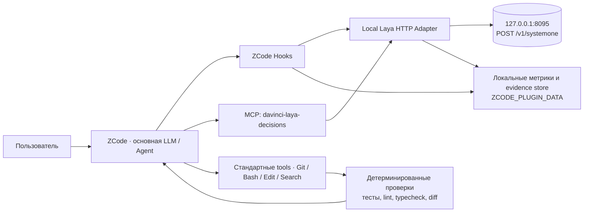

# DaVinci · ZCode × Local Laya — техническое задание v1.0

> Статус: проект архитектуры по открытой документации (14.10.2026). Установка в пользовательский ZCode и доступность локального `127.0.0.1:8095` **не проверялись**. Перед реализацией требуется discovery фактической сборки ZCode и контракта сервера.

## 1. Цель и границы

**ZCode остаётся главным coding-агентом**: планирует задачи, читает репозиторий, пишет код, запускает инструменты, разговаривает с пользователем. **Laya становится локальным decision-engine (System One)** для недорогих, быстрых, типизированных решений: `choice`, `noul`, `score`. Она не является заменой основной LLM, не пишет код и не проводит полноценный security/code review.

**Текущий адрес Laya:** `http://127.0.0.1:8095`. Никаких запросов в TypeSafe/AnythingMCP не требуется.

Цель: повысить качество и предсказуемость агентных циклов, сократить ненужные вызовы тяжёлых моделей и объём контекста там, где это действительно можно измерить, не создавая ложного чувства безопасности.

## 2. Что дают три изученные статьи

1. **APIMaster / Jev + Claude Code/Codex:** decision-модель лучше встраивать в точки принятия решений — гейты инструментов, стоп-проверки, отбор контекста, маршрутизацию; не подменять ею главную генеративную модель. Аналоги: `jev-axi`, `jev-belay`, `jev-pruner`, `fast-jev-compaction`, `jev-router`, `jev-mcp`.
2. **AnythingMCP / Jev:** MCP предоставляет агенту явные функции классификации, бинарной проверки и оценок с вероятностями. Свою локальную Laya можно обернуть тем же образом; облачный прокси и API-ключ TypeSafe не нужны.
3. **WebSansay / видео skill:** полезен архитектурный принцип «модель решает → детерминированные инструменты исполняют → QA проверяет артефакт». Автомонтаж как функция — отдельный опциональный skill, а не причина модифицировать всю среду coding-агента. Цифры задержек и качества из маркетинговых статей нельзя считать измерениями на рабочем ПК.

## 3. Реальные точки расширения ZCode

По официальной документации ZCode: plugin (`.zcode-plugin/plugin.json`) может упаковать `hooks/hooks.json`, `skills/<name>/SKILL.md`, `commands/*.md`, `agents/*.md`, `.mcp.json`.

**Поддерживаемые события хуков:**
- `SessionStart` — начальная настройка/контекст, в том числе source `compact`.
- `UserPromptSubmit` — классификация входной задачи; можно добавить контекст, но **нельзя переписать** исходный запрос и штатным хуком **нельзя напрямую сменить модель**.
- `PreToolUse` — проверить/запросить подтверждение/запретить вызов до исполнения; `updatedInput` заменяет *весь объект*, не часть.
- `PermissionRequest` — настройка решений по запросу разрешений; лучше оставить штатные политики, не разрешать опасные вызовы только по Laya.
- `PostToolUse` / `PostToolUseFailure` — добавить рекомендации; **нельзя заменить/укоротить оригинальный tool output**.
- `Stop` — проверить право на завершение и разово вернуть управление основной модели (штатно максимум 3 продолжения подряд).

**Неподтверждённые / отсутствующие возможности:** документированного `PreCompact` и API для замены встроенной компакции нет. Порт `fast-jev-compaction` из Claude Code не станет полноценной компакцией ZCode просто копированием. Для реальной экономии контекста нужны MCP-обёртки вокруг чтения/поиска/логов либо подтверждённый доступ к механизму компакции ZCode. В пользовательском `<workspace>/.zcode/config.json` проектные hooks не исполняются; hooks следует упаковать в plugin или настроить глобально.

## 4. Целевая архитектура



Компоненты:

| Компонент | Назначение | Сеть | Приоритет |
|---|---|---|---|
| `LayaAdapter` | Проверка схемы, короткий state, запросы, таймаут, валидация ответа | loopback HTTP | P0 |
| `LayaMCP` | `laya_decide`, `laya_classify`, `laya_score`, `laya_batch`, `laya_health` | ZCode ⇄ stdio ⇄ loopback | P0 |
| `RiskGate` | PreToolUse: предупреждать о потенциально разрушительных вызовах | loopback | P0 |
| `DoneGate` | Stop: определять, когда **нужна** допроверка; доказательства берутся из тестов | loopback | P1 |
| `EvidenceLedger` | Минимальная история изменённых файлов, тестов, результатов и причин вердиктов | только локально | P1 |
| `ContextSelector` | Отбор релевантных search/log блоков **до** попадания в LLM | loopback через обёртки | P1 |
| `TaskRouter` | Рекомендация класса задачи и модели; реальный switch только через поддерживаемый канал ZCode | loopback | P2 |
| `Analytics` | A/B, p50/p95, token-cost, ошибки гейтов, доля пропусков | локально | P1 |
| `ReelEditorSkill` | Необязательный конвейер ASR → decisions → FFmpeg → QA | локально | P3 |

## 5. Контракт Laya и важнейшее ограничение длины

Предполагаем, что `laya-server` реализует Jev-compatible API (`GET /v1/models`, `POST /v1/systemone`). Пример для обнаружения сервера в PowerShell:

```powershell
Invoke-RestMethod 'http://127.0.0.1:8095/'
Invoke-RestMethod 'http://127.0.0.1:8095/v1/models'

$req = @{
    model = 'laya'
    state = 'Operation: git reset --hard; workspace has uncommitted changes.'
    questions = @{
        destructive = @{
            type = 'noul'
            instructions = 'Would this operation destroy uncommitted user changes?'
        }
        risk = @{
            type = 'choice'
            instructions = 'Choose the risk category.'
            criteria = @{
                low = 'Read-only or trivially reversible operation'
                medium = 'Changes ordinary project files with recovery available'
                high = 'Data loss, secret exposure, or irreversible external effect'
            }
        }
    }
}
Invoke-RestMethod -Method Post `
    -Uri 'http://127.0.0.1:8095/v1/systemone' `
    -ContentType 'application/json; charset=utf-8' `
    -Body ($req | ConvertTo-Json -Depth 20)
```

Ни один выход Laya не разрешает автоматически выполнять опасную команду. Пример лишь проверяет возможность получения вероятностей.

**Важное ограничение обнаруженного проекта `nvkudva/laya-server`:** каждый вопрос кодируется с отдельной копией `state`, длинный ввод *молча обрезается*. `laya` — до 512 токенов на вопрос, `laya-multilingual` и `laya-typed-decisions` — до 1024; часть бюджета занимают инструкции и критерии. Для `laya` под state может оставаться около 320 токенов. Поэтому НЕЛЬЗЯ скармливать diff на 10 000 строк, лог целиком или рассчитывать, что модель прочитала весь контекст. Протокол и фактически запущенный checkpoint обязательно проверить в `/v1/models`, тестах и логах. Если установлен *другой* `laya-serve`, детали отличаются.

Рекомендация: для задач агента рассмотреть `laya-typed-decisions` (1024 tokens) и отдельно замерить качество русского против `laya-multilingual`. Числа с чужого железа не переносить; измерить на рабочей станции.

## 6. Политика решений, не смешивать вероятность и доказательство

- `Laya` выдаёт **оценку/вероятность**, не логическое доказательство, не статический анализ и не факт выполнения тестов.
- Детерминированные правила (например, пути вне workspace, удаление файлов, отправка секретов, PowerShell shell-команда) обладают приоритетом над решениями модели.
- Первоначально `RiskGate` работает в `shadow`: пишет risk score и не меняет разрешения. После тестов можно поднять `high-risk` в `ask`, но **никогда** не использовать низкий риск для `allow` поверх существующих ограничений.
- При таймауте, ответе с неправильной схемой, отключении Laya — продолжать штатную работу ZCode, **не делать авторазрешений**.
- Laya не видит историю предыдущих сообщений автоматически. При необходимости сериализовать только минимальное и проверяемое evidence-состояние.
- Все пороги — конфигурация и предмет измерения; стартовые значения не являются калиброванной гарантией.

### 6.1. P0 — RiskGate на PreToolUse

Запускать прежде всего на `Bash`, `Write`, `Edit` и фактических названиях аналогичных инструментов (сначала собрать telemetry). Передать одновременно 3 вопроса: `potential_data_loss` (`noul`), `secret_or_exfiltration_risk` (`noul`), `risk_class` (`choice low/medium/high`). В state включить тип tool, усечённые аргументы, нормализованный путь относительно workspace, `git status --porcelain` как доказательство **если оно уже имеется**, а не новые тяжёлые вызовы.

**Примеры:** `git reset --hard`, удаление папки, `curl` со строкой токена, массовый `chmod`, изменение `.env`, запись в production-конфиг. Для таких действий должны существовать **детерминированные** правила; Laya применяется для подозрительных неоднозначных случаев, а не как единственный барьер.

### 6.2. P1 — DoneGate на Stop

Цель — остановить «готово», когда требуется проверка. Минимальный ledger: `changed_files`, `test_commands`, `exit_codes`, `unresolved_errors`, `claimed_completion`, `test_evidence_hash`. Если затронут код, а тесты ни разу не запускались, это **детерминированный факт**; Laya не нужна, чтобы его узнать. Laya помогает классифицировать, насколько обоснованы дополнительные проверки при неполных или противоречивых данных.

Первый запуск: только предупреждение/log. После валидации: `Stop` возвращает `{"decision":"block","reason":"..."}` исключительно для проверенных условий, с ограничением повторных продолжений; не создаёт бесконечные циклы. Отсутствие тестовой инфраструктуры должно допускать явное `untested` в финальном отчёте, а не ложный `passed`.

### 6.3. P1 — экономия контекста: ContextSelector

Не пытаться сделать это штатным `PostToolUse`: **этот хук не заменяет вывод**. Вместо этого предоставить специализированные MCP-инструменты, которые сразу возвращают компактные сведения:

- `laya_search_relevant(query, file_hits)` — ранжирование *заголовков/путей/коротких snippets*; затем дочитывание полного исходника обычным инструментом только для top-k.
- `laya_log_triage(log_chunks)` — поиск важнейших ошибок по детерминированным regex/exit code, Laya оценивает *важность блоков*, но не удаляет корневую причину.
- `laya_context_pick(artifacts)` — `keep / archive / fetch_on_demand`, pinned: пользовательские требования, ошибки, пути, принятые решения, последнее изменение, доказательства тестов.

Каждый обрезанный блок хранить вне контекста с идентификатором, хешем и возможностью `get_full_chunk(id)`. Избыточный Laya-сервис нельзя вызывать на каждый файл: сначала grep/индекс/AST, затем несколько небольших сравнений. Не заниматься агрессивным удалением истории обычным hook.

### 6.4. P2 — TaskRouter и выбор дорогой/дешёвой модели

Laya классифицирует пользовательское задание на `fast / balanced / deep`, отмечает неопределённость и риски. **В ZCode штатный `UserPromptSubmit` может добавить рекомендацию, но не гарантирует переключение активного провайдера**. Реальную модель можно назначать через документированные `model` в определении subagent или slash-command, либо через отдельный провайдер/router после исследования модели и API. При ошибке роутера — сохранить исходную выбранную модель.

Рекомендуемый режим: сперва логировать решения, затем добровольный `/fast` или `/deep`, только потом автоматическая маршрутизация на реально поддерживаемой интеграционной поверхности. Переоценить cache misses, большие промпты и стоимость повторных вызовов.

### 6.5. P3 — optional Skill «AI video editing»

Не включать в общие coding-hooks. Отдельный skill: локальный ASR (word timestamps), deterministic cut rules, Laya для коротких классификаций «дубль/плашка/сцена», FFmpeg/Python для рендера, QA по freeze/blank/sync, воспроизводимый результат и лимит повторного рендера. Из статьи заимствовать подход, **не** выключение подтверждений безопасности и не обещания «идеального монтажа за 2 минуты».

## 7. Workflow и точки контроля

```mermaid
sequenceDiagram
    participant Z as ZCode Agent
    participant H as Plugin hook
    participant L as Laya 8095
    participant X as Shell / Git / Tests
    participant E as Evidence ledger
    Z->>H: PreToolUse(command, workspace)
    H->>L: POST /v1/systemone (3 short questions)
    alt local inference timeout / malformed response
        H-->>Z: no change; standard permissions
    else risk uncertain / elevated
        H-->>Z: suggestion or ask (after validation)
    else ordinary tool
        H-->>Z: no change; standard permissions
    end
    Z->>X: execute permitted tool
    X-->>Z: output and exit status
    Z->>H: PostToolUse / PostToolUseFailure
    H->>E: record sparse evidence; no secrets
    Z->>H: Stop (claimed done)
    H->>E: load test evidence
    alt unverified completion
        H-->>Z: report gap / bounded continuation
    else evidence sufficient
        H-->>Z: finish normally
    end
```

## 8. Структура плагина

```text
davinci-laya-zcode/
├── marketplace.json
└── plugins/
    └── davinci-laya-decisions/
        ├── .zcode-plugin/plugin.json
        ├── .mcp.json
        ├── package.json
        ├── src/
        │   ├── laya-client.ts           # fetch, timeout, schemas, short state
        │   ├── decision-policy.ts       # thresholds, fail-open, deterministic veto
        │   ├── mcp-server.ts            # 5 explicit MCP tools
        │   ├── evidence-ledger.ts       # file-backed, per session
        │   └── telemetry.ts
        ├── hooks/
        │   ├── hooks.json
        │   ├── pre-tool.mjs
        │   ├── post-tool.mjs
        │   └── stop.mjs
        ├── skills/
        │   └── laya-decision-workflow/SKILL.md
        ├── commands/
        │   ├── laya-status.md
        │   ├── laya-review.md
        │   └── laya-bench.md
        ├── tests/
        │   ├── contract.test.ts
        │   ├── gate-fixtures.test.ts
        │   ├── mcp-smoke.test.ts
        │   └── replay.test.ts
        └── README.md
```

Пример минимального манифеста (в каталоге плагина):

```json
{
  "name": "davinci-laya-decisions",
  "version": "0.1.0",
  "description": "Local Laya decisions, MCP tools and ZCode validation hooks",
  "author": "DaVinci Cyber Engineering",
  "license": "MIT"
}
```

`hooks/hooks.json` обнаруживается автоматически. **Не дублировать** его в `plugin.json`. Пример начального shadow-режима:

```json
{
  "hooks": {
    "PreToolUse": [{
      "matcher": "Bash|Write|Edit",
      "hooks": [{
        "type": "process",
        "command": "node",
        "args": ["${ZCODE_PLUGIN_ROOT}/hooks/pre-tool.mjs"],
        "timeoutMs": 5000
      }]
    }]
  }
}
```

В первом релизе этот hook **только записывает решение локально** и не возвращает `permissionDecision=allow/deny`. В `PreToolUse` допускается `ask` только после тестов. `PostToolUse` предназначен для append/evidence, не для подмены stdout. Обработчики пишут только JSON-результат в stdout; диагностику — stderr. Метрики и состояние — под `ZCODE_PLUGIN_DATA`. Реальная реализация MCP-stdio требует корректной реализации Model Context Protocol; **HTTP Jev endpoint нельзя прописывать в ZCode как готовый MCP URL**.

## 9. Требования к качеству и безопасности

1. Локальность: `127.0.0.1:8095`; не открывать на `0.0.0.0` без отдельной авторизации и сети. Не передавать секреты в state; маскировать `.env`, bearer tokens, SSH keys, URL credentials, cookie и содержимое закрытых файлов.
2. Таймаут/ошибка: Laya 1–5 секунд (конфиг), circuit breaker после серии сбоев, безопасный отказ к стандартному ZCode, никакого автоматического `allow`.
3. Токен-бюджет state: измерять *перед* инференсом; учитывать фактический checkpoint, маркеры усечения, проверять, что существенный факт помещается; для многословного русского особенно критично.
4. Гейты тестировать на множестве намеренно опасных и безопасных примеров; метрики false-negative / false-positive, latency, доля отказов от решения.
5. QA должны исполнять реальные команды (`tests`, `lint`, `typecheck`, валидаторы), а не только доверять утверждениям самой модели.
6. Политика удаления контекста: всегда хранить ссылку на первоисточник и pinned user requirements. Вероятностное удаление целых сообщений без replay запрещено на первом этапе.
7. Все решения логируются локально кратко: `session_id`, `tool`, `latency_ms`, `checkpoint`, `question_set_version`, `state_hash`, `scores`, `action`, `reason`, `inference_error`; не сохранять реальные секреты и полный prompt по умолчанию.
8. Версионирование: отдельно checkpoint Laya, шаблоны вопросов, пороги, сборка плагина, версия ZCode; изменения через A/B replay.
9. MCP-сервер не должен получать writable filesystem без явной необходимости. Hooks выполняются с правами пользователя; проверять плагин перед установкой.

## 10. Экономия токенов — измерять, а не обещать

Экономия **не** равна сумме быстрых вызовов Laya. Важна разность основного потребления ZCode:

`NetSavings = baseline_MainLLM_Tokens - experiment_MainLLM_Tokens - extra_MainLLM_Tokens_from_added_hook_context`.

Отдельно — `wall_time`, число тяжёлых inference-turns, cache miss/потери кэша, стоимость или квота, доля успешных задач. Если MCP вызвал Laya, но главная модель всё равно получила тот же полный вывод, **экономии контекстных токенов нет**; возможно даже увеличение.

**A/B:** одинаковые реальные задачи и репозитории, фиксированные условия, 3 режима: A = ZCode без плагина; B = Laya shadow / gate; C = gate + специализированные MCP-обёртки. Замерять медиану и p95, качество (проход тестов, регрессии, повторные исправления), FNR/FPR гейтов. Эффект на разные платные модели будет отличаться. Маркетинговое «в 10 раз» не использовать как прогноз.

## 11. Порядок внедрения и приёмка

### Этап 0 — Discovery (обязательный)

- Проверить доступность `127.0.0.1:8095`, `GET /`, `GET /v1/models`, `POST /v1/systemone`.
- Проверить фактический вариант server (`nvkudva/laya-server`, `laya[serve]` или иной), checkpoint, /batch, auth, реальные latency/limits.
- Проверить актуальную версию ZCode, включение plugin hooks и стандартные названия tool calls.
- Сохранить 20–50 типовых анонимизированных ZCode-сессий/задач и baseline-метрики.

**Приёмка:** реальные 3 типа вопросов (`noul`, `choice`, `score`) проходят без ошибок и распознаётся checkpoint.

### Этап 1 — Плагин + MCP, shadow

- Реализовать `LayaAdapter`, `laya_health`, `laya_decide`, `laya_classify`, `laya_score`.
- Упаковать plugin, создать локальный `marketplace.json`, установить через Settings → Plugins → Create → Add marketplace.
- PreToolUse логирует оценки без вмешательства в безопасность. Доказать совместимость Windows/PowerShell/Node 24.
- Проверить отсутствующий Laya: ZCode продолжает работу.

**Приёмка:** >99% успешных корректных запросов на доступном сервере; отсутствие модификации существующих разрешений; любые таймауты не ломают ZCode.

### Этап 2 — Проверка завершения и рисков

- Локальный `EvidenceLedger` + отслеживание tests/changes; сначала только отчёт.
- Автоматическое `ask` для подтверждённо рискованных классов — после калибровки и тестирования.
- Валидация 50+ кейсов с обфусцированными/безопасными командами, многословными русскими запросами, сбоями сети, длинными args.
- При необходимости Stop разрешить **одну** дополнительную проверку на пользовательскую задачу (а не бесконечные циклы).

**Приёмка:** не снижена безопасность, нет ложных `test passed`, изменения всегда отражены в отчёте.

### Этап 3 — Контекст и экономия

- Реализовать собственные MCP-tools для `search/log/large output`, в которых Laya **ранжирует короткие chunks**, а оригинал хранится для выборочного дочитывания.
- Отладить альтернативные эвристики без Laya (`grep`, head/tail, AST) и принимать вариант, который реально лучше.
- A/B на типовых длинных coding-сессиях, следить за модельным prompt cache.

**Приёмка:** экономия >0 по реальным главным токенам при сопоставимом проходе тестов; если это не соблюдается, вернуть baseline.

### Этап 4 — Роутинг (не раньше evidence)

- Проверить поддерживаемый API смены модели в конкретной сборке ZCode; не подменять внутренний маршрут недокументированными полями.
- Реализовать user commands/subagents со статическим `model` или отдельный роутер при подтверждённой совместимости API.
- Ограничить рост стоимости из-за срывов кэша и дополнительных переспросов.

**Приёмка:** выбранный пользователем вариант модели всегда имеет приоритет; ошибки Laya не меняют выбранную модель; качество сохраняется.

## 12. Первоисточники

- https://apimaster.ai/ru/blog/jev-claude-code-codex
- https://anythingmcp.com/ru/guides/connect-jev-to-claude
- https://hub.websansay.com/prompts/ai-video-editing-skill-claude-code
- https://zcode.z.ai/en/docs/plugin
- https://zcode.z.ai/en/docs/hooks
- https://zcode.z.ai/en/docs/mcp-services
- https://zcode.z.ai/en/docs/subagents
- https://zcode.z.ai/en/docs/usage-stats
- https://github.com/nvkudva/laya-server
- https://laya-ai.com/guides/self-host-laya
- https://github.com/tamaratran/fast-jev-compaction
- https://github.com/leonaaardob/fast-dev-compaction

**Итог:** реализуем **один локальный плагин** в ZCode с двумя доступами к одному Laya — автоматически через hooks и по требованию через MCP. Стартуем с discovery и безопасного `shadow`, затем вводим кодовый QA и контекстные инструменты. Не копируем Claude-specific механизмы компакции и не ждём от Laya генерации кода.
